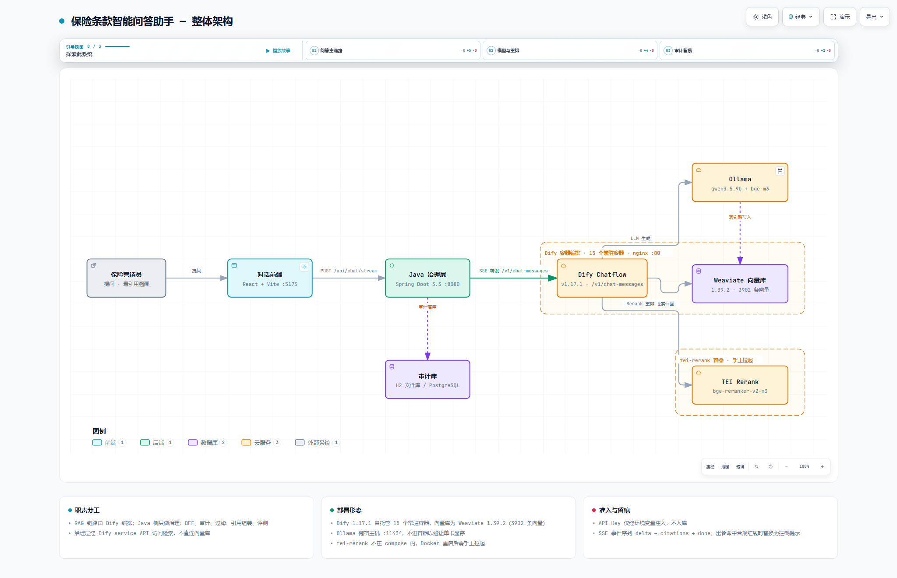
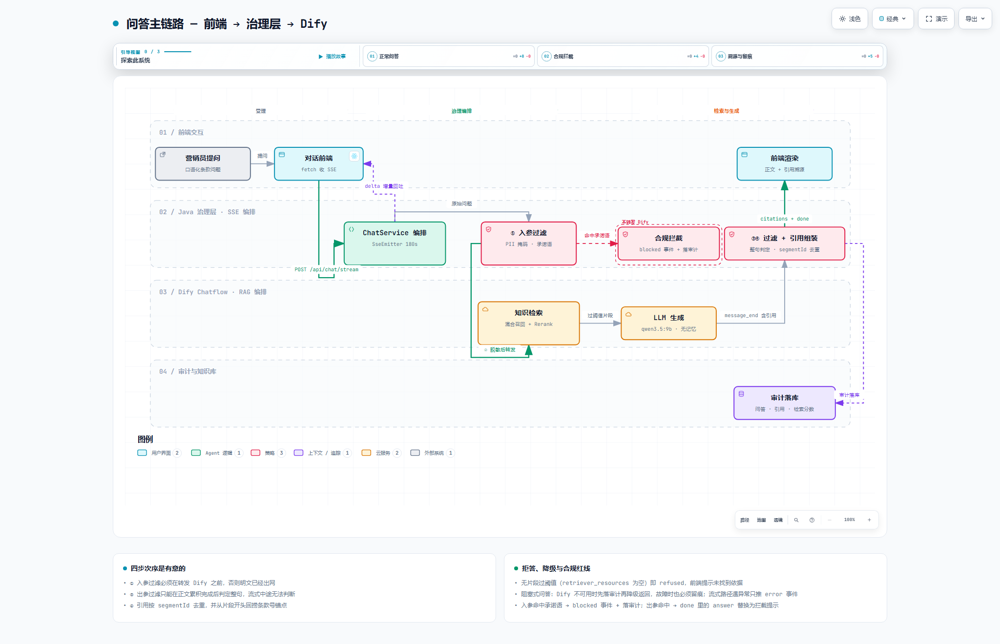

# 保险条款智能问答助手 — 代码说明

RAG 链路由 **Dify** 编排，本仓库的 Java 侧是**治理层**（BFF + 审计 + 过滤 + 引用组装 + 评测），
前端是对话界面。整体架构与决策依据见 `docs/`。

---

## 架构图

图源在 `docs/archify/`（Archify 生成的可交互页面）。下面两张是静态快照，会跟随
你的浅色 / 深色主题切换；想点节点看依赖、或导出演示动效，打开 HTML 交互版。

### 整体架构

<picture>
  <source media="(prefers-color-scheme: dark)" srcset="docs/archify/architecture.visual-check.2048x1320.dark.png">
  
</picture>

交互版：[`docs/archify/architecture.html`](docs/archify/architecture.html)

### 问答主链路

<picture>
  <source media="(prefers-color-scheme: dark)" srcset="docs/archify/chat-flow.visual-check.2048x1320.dark.png">
  
</picture>

交互版：[`docs/archify/chat-flow.html`](docs/archify/chat-flow.html)

---

## 目录结构

```
RAG_demo/
├── backend/                     Java 17 + Spring Boot 3.3 治理层
│   └── src/main/java/com/insurance/rag/
│       ├── config/DifyProperties        Dify 配置（密钥只存服务端）
│       ├── dify/DifyClient              Chatflow SSE 客户端
│       ├── dify/DifyEvents              Dify 事件与 metadata 映射
│       ├── filter/SensitiveDataFilter   FR-08 敏感过滤
│       ├── citation/Citation            FR-06 引用模型
│       ├── citation/CitationAssembler   metadata → 结构化引用
│       ├── chat/ChatService             问答编排（过滤→Dify→组装→落库）
│       ├── domain/Conversation          FR-07 审计记录
│       └── repository/                  JPA 仓储
├── frontend/                    React + Vite 对话界面（流式 + 溯源回看）
├── eval/                        评测（FR-09）
│   ├── eval_cases_v2.json       评测集 52 条（v0 的 23 条 + 新设计 29 条）
│   ├── run_iteration.py         闭环评测器：前端取数 → 逐条落盘 → 失败归因 → 跨轮对比
│   ├── trace_stages.py          链路 trace：三段对照探针（只检索不调 LLM，约 100 秒）
│   ├── attribute_funnel.py      漏斗归因：把「过/不过」翻译成卡在哪一环、该拧哪个旋钮
│   ├── run_eval.py              v0 批量评测（保留）
│   ├── prompts/                 提示词版本
│   └── runs/<tag>/              每轮结果留档（raw.jsonl / report.md / summary.json
│                                 / trace.jsonl / attribution.jsonl / funnel_report.md）
├── data/source/                 已验证的条款 PDF + 清洗后文本
├── docs/                        需求文档 V1.2、实测报告、迭代报告、启动手册
│   └── archify/                 架构图源文件（可交互 HTML + 浅/深色快照 PNG）
└── scripts/
    ├── dify_params.py           Dify 参数读写 + 快照/回滚（node. 前缀区分作用域）
    ├── close_loop.ps1           闭环一键：快照 → 评测 → trace → 归因（强制同轮）
    ├── dump_corpus.py           全库片段快照 + 切割质量诊断
    ├── verify_trace_funnel.py   守门：检索漏斗三段确实能切开
    ├── sweep_retrieval.py       参数扫描（只检索不调 LLM，一组 8 秒）
    ├── reset_dify_password.py   Dify 密码重置（你写的）
    ├── verify_governance.py     治理层端到端验证（13 项断言）
    └── 知识库清理管线（§9，可复现，勿当临时脚本删）
        ├── strip_toc_pages.py           裁掉封面/阅读指引/条款目录页
        ├── verify_no_body_loss.py       证明只删了目录、正文一字未少
        ├── reingest_kb.py               用裁剪版替换 Dify 知识库
        ├── verify_toc_gone.py           检索层验证目录噪声归零
        ├── recheck_toc_on_r004.py       核对目录噪声判据口径
        ├── probe_delta_vs_done_space.py SSE 空格守门（修复后逐字相同）
        └── verify_markdown_fixed.py     markdown 标记守门
```

---

## 运行

### 1. 后端

**方式 A（推荐 · 分离进程）** —— 服务脱离终端生命周期，关掉终端也在跑：

```powershell
# 首次先打包
cd backend
$env:JAVA_HOME="C:\Program Files\Eclipse Adoptium\jdk-17.0.20.101-hotspot"
$env:Path="$env:JAVA_HOME\bin;D:\tools\apache-maven-3.9.16\bin;$env:Path"
mvn -DskipTests package

# 启动（脚本会等待端口就绪并打印 PID，实测 ~13 秒）
powershell -ExecutionPolicy Bypass -File scripts\start-backend.ps1
```

日志在 `backend/backend.log`；停止用脚本打印的 `Stop-Process -Id <PID>`。

**方式 B（最省事）** —— 在 IDE 里直接运行 `InsuranceRagApplication`，
或 `cd backend && java -jar target\insurance-rag-backend-0.1.0.jar`。

> ⚠️ 不要用 `mvn spring-boot:run` 长时间挂在自动化终端里——
> 常驻进程会被执行器的超时机制杀掉（实测 900 秒后被终止）。

#### 启动脚本踩过的坑（都写在 `start-backend.ps1` 注释里）

| 坑 | 现象 | 修法 |
| --- | --- | --- |
| `powershell` 是 **Windows PowerShell 5.1**，把无 BOM 的 UTF-8 按 GBK 解析 | 脚本中文乱码、**ParserError 且报错行号对不上** | 文件存为 **UTF-8 带 BOM** |
| `Start-Process -RedirectStandard*` | java 继承 PowerShell 管道句柄，脚本退不出被超时杀 | 不重定向，日志交给 Spring 自己写（`logging.file.name`） |
| CIM/WMI 进程工作目录是 `C:\Windows\System32` | H2 相对路径落到 System32：`Error while creating file ""C:/Windows/System32/data""` | 用 `-Dapp.data.dir=<绝对路径>`（`-D` 在 `-jar` 前，不含分号，不会被 cmd 引号规则吃掉） |
| 反引号续行符 | 续行静默失效，`-ArgumentList` 被当成独立命令 | 参数用数组传，不用续行符 |
| **jar 正被运行中的 java 进程加载** | `mvn package` 在 `spring-boot:repackage` 阶段报 `Unable to rename ...jar`；更糟的是它**已先用 jar 插件写了一个瘦 jar 覆盖掉 fat jar**，产物直接不可执行 | 打包前先 `scripts\stop-backend.ps1`。「repackage 失败」别当成 jar 损坏去排查 |
| **`mvn` / `python` 不在 PATH** | 直接敲 `mvn` 或 `python` 报「不是内部或外部命令」 | 本机 Maven 用绝对路径 `D:\tools\apache-maven-3.9.16\bin\mvn.cmd`；Python 是 `C:\Python312\python.exe`，无 venv |

默认用 H2 文件库（`backend/data/`），**不需要起数据库容器**即可跑通全流程。
切 PostgreSQL 只需改 `application.yml` 的 datasource 三行。

**密钥通过环境变量注入，不入库：**

```powershell
$env:DIFY_APP_API_KEY="app-xxxx"
$env:DIFY_DATASET_KEY_CRITICAL="dataset-xxxx"
$env:DIFY_DATASET_KEY_MEDICAL="dataset-xxxx"
```

### 2. 前端

```powershell
# 推荐：分离进程启动，等端口就绪并打印 PID（与后端同思路）
powershell -ExecutionPolicy Bypass -File scripts\start-frontend.ps1
强制重启（端口被占用时先停旧进程）：
powershell -ExecutionPolicy Bypass -File scripts\start-frontend.ps1 -Force
停止：Stop-Process -Id <PID>
```

或直接跑（依赖终端生命周期）：

```powershell
cd frontend
npm install
npm run dev        # http://localhost:5173，已配 /api 代理到 8080
```

⚠️ 别把 `npm run dev` 长期挂在自动化终端里——常驻进程会被执行器的
超时机制杀掉（同 `mvn spring-boot:run` 的坑）。

### 3. 验证治理层（不依赖 Dify）

```powershell
& "C:\Python312\python.exe" scripts\verify_governance.py
```

13 项断言，覆盖入参过滤、脱敏落库、拒答降级、审计完整性。
**Dify 没配好也能跑**——治理层必须独立可验。

---

## Dify 侧配置（需在 Web UI 操作）

| 用途 | Provider | 参数 |
| --- | --- | --- |
| LLM | Ollama | `http://host.docker.internal:11434` + `qwen3.5:9b` |
| Embedding | Ollama | 同上 + `bge-m3:latest` |
| Rerank | Text Embedding Inference | `http://tei-rerank:80` |

当前检索参数（已调优定档）：

| 参数 | 值 | 在哪配 |
| --- | --- | --- |
| `score_threshold` | **0.1** | **检索节点** `multiple_retrieval_config`（知识库级同步改） |
| `top_k` | **30** | 同上。⚠️ **33 以上会静默返回空集** |
| 向量 / 关键词权重 | 0.7 / 0.3 | 知识库级 `datasets.retrieval_model`（实测调了没用） |
| `temperature` / `think` | 0.1 / false | LLM 节点 `model.completion_params` |

⚠️ **三份条款**（个人住院医疗 / 团体百万医疗 / 重疾E）**必须用同一个 Embedding 模型**，
否则 Dify 的权重设置不可用。

⚠️ 应用是 **Chatflow**，API 端点 `/v1/chatflow/chat-messages`。

🔴 **目前只有一个知识库，多份条款混在一起**，检索前没有产品约束——
这是跨产品串档（4/42）和同名章节错配（3/42）的根因。
拆双知识库 + 问题分类器路由是下一阶段的首要任务。
在拆库之前，**产品维度的准确率没有解**。

> 📌 当前知识库**实入 2 份**（个人住院医疗 / 重疾E，均已剔除目录页）。
> 团体百万医疗在 `data/source/` 有 PDF 但未入库——评测里 G-01~G-05 五条团体题
> 因此必然失败。补录它会改变评测口径，需单独一轮基准。

---

## 评测

评测集 52 条（`eval/eval_cases_v2.json`），取数走前端同款链路
（`POST /api/chat/stream`，SSE 解析与 `frontend/src/App.jsx` 逐行一致），
每条结果**即时落盘**到 `eval/runs/<tag>/raw.jsonl`。

```powershell
# 单轮全量评测（52 条约 15 分钟；--workers 并发在本机无效，Ollama 串行处理）
& "C:\Python312\python.exe" eval\run_iteration.py --tag r001 --workers 2

# 中断续跑：已跑过的不重测。**判据改了也用它免费重判，不必重新发请求**
& "C:\Python312\python.exe" eval\run_iteration.py --tag r001 --resume

# 跨轮对比
& "C:\Python312\python.exe" eval\run_iteration.py --compare r001_baseline r003_node010

# 看所有轮次概览
& "C:\Python312\python.exe" eval\run_iteration.py --list-runs
```

失败不是只记「过/不过」，而是**归因**并按危险度排序：

| 归因 | 含义 | 危险度 |
| --- | --- | --- |
| `wrong_product` | 引用里只有错误产品的文档 | 🔴 危 |
| `clause_mismatch` | 召回了同名章节，但编号/文档对不上 | 🔴 危 |
| `citation_miss` | 答了但引用没兜住期望条款 | 🔴 危 |
| `under_refusal` | 该拒却给了引用答案 | 🔴 危 |
| `over_refusal` | 该答却拒答 | 🟠 重 |
| `coverage_gap` | 引用对、答了，但关键信息点缺失 | 🟡 轻 |

### 卡在哪一环：漏斗 trace（调参前的必读）

上面那张表是**结果层**归因，它能回答「引用没兜住期望条款」，
但答不出**卡在哪一环**——而每种卡点要拧的旋钮完全不同。
把五种情况混在一个 `passed=False` 里，调参就只能靠猜，
且每轮 15 分钟的代价会把「猜错方向」放大到整轮报废。

`trace_stages.py` 用**对照探针**把漏斗切开。同一个 query 只改一个旋钮：

| 段 | 配置 | 它告诉你什么 |
| --- | --- | --- |
| `A_retrieval_only` | 关 rerank + 阈值 0 + top_k 32 | 混合检索的原始候选池 |
| `B_reranked_full` | 开 rerank + 阈值 0 + top_k 32 | rerank 之后的**全部分数**（未被阈值砍） |
| `C_live_params` | 线上原样 | 真正进入 LLM 的那批 |

再叠一层**语料层**判定（`scripts/dump_corpus.py` 拉的全库快照）：
期望章节此刻在不在库里、在哪份文档、编号对不对。
这是唯一能把「库里就没有」和「在库里没捞上来」分开的地方——
而这两件事的解法完全不相干。

```powershell
# 先确认漏斗结构成立（否则后面全是假绿）
& "C:\Python312\python.exe" scripts\verify_trace_funnel.py

# 两层判据的自检（不触网，几秒钟）
& "C:\Python312\python.exe" eval\trace_stages.py   --selftest   # 语料层四档
& "C:\Python312\python.exe" eval\attribute_funnel.py --selftest  # 归因分支 12 条

# 一键闭环：快照 → 评测 → trace → 归因（强制同轮）
powershell -ExecutionPolicy Bypass -File scripts\close_loop.ps1 -Tag r007
中断后续跑：
powershell -ExecutionPolicy Bypass -File scripts\close_loop.ps1 -Tag r007 -Resume

# 闭环的最后一环：预测 → 改参数 → 重跑 → 检验预测。
# 只检索不调 LLM，一轮 96 秒，所以参数实验很便宜。
& "C:\Python312\python.exe" eval\trace_stages.py --tag t008_th005 --live-threshold 0.05
& "C:\Python312\python.exe" eval\attribute_funnel.py --tag t008_th005 --threshold 0.05
```

产物在 `eval/runs/<tag>/`：`funnel_report.md`（含端到端×瓶颈交叉表）、
`attribution.jsonl`（逐条归因）、`trace.jsonl`（每段候选池明细，可回查）。

**必须同轮采集。** trace 采于某一时刻、raw 跑于另一时刻，
期间只要动过参数或索引，就会出现「trace 说期望章节进了上下文 /
raw 说引用里没有」这种**假矛盾**。报告会把它标成 `trace_conflict` 而不是硬猜，
但正确做法是让两者来自同一次调用。

### 调参：先扫后验，不要一上来就跑全量

全量评测一轮 15 分钟，扫参数却要几十上百组。Dify 的
`/v1/datasets/{id}/retrieve` **只检索不调 LLM**，一组 8 秒，用它先扫：

```powershell
& "C:\Python312\python.exe" scripts\sweep_retrieval.py --stage threshold   # 阈值
& "C:\Python312\python.exe" scripts\sweep_retrieval.py --stage knn         # top_k / 权重
```

命中入选后，再用全量评测验证。⚠️ **改阈值必须改节点级**——见 `docs/项目启动手册.md` §6.5。

### 知识库清理（剔除目录/封面页）

条款 PDF 的封面、阅读指引、条款目录对「犹豫期/等待期」这类词面命中极高，
会把正文条款挤出候选。这是**数据侧问题**，调参救不了（`docs/评测迭代报告.md` §5.1）。
管线可复现，按顺序跑：

```powershell
& "C:\Python312\python.exe" scripts\strip_toc_pages.py --apply   # 裁页 -> data/source/noc/
& "C:\Python312\python.exe" scripts\verify_no_body_loss.py       # 断言：裁剪版是原文严格后缀
& "C:\Python312\python.exe" scripts\reingest_kb.py --apply       # 删旧文档 + 传裁剪版 + 等索引
& "C:\Python312\python.exe" scripts\verify_toc_gone.py           # 检索层验证噪声归零
```

`reingest_kb.py` 默认**只替换知识库里已有的文档**，不擅自补录新文档——
补录会改变评测口径。`eval/runs/kb_doc_swap.json` 留了换档记录，可按 id 手工回滚。

### 验收线与当前实测

| 指标 | 验收线 | r004 实测（参数天花板） | r005 实测（已剔目录页） |
| --- | --- | --- | --- |
| 应答类命中率 | ≥85% | 48% ❌ | 38% ❌ |
| 拒答类正确率 | ≥85% | 90% ✅ | 90% ✅ |
| 跨产品题 | ≥90% | 50% ❌ | 25% ❌ |
| 口语问法 | ≥75% | 36% ❌ | 29% ❌ |
| 引用命中率 | ≥90% | 65% ❌ | 38% ❌ |
| 目录页噪声（诊断项） | — | 11/52 | **0/52** ✅ |

⚠️ **两列不可直接相减。** r005 在剔除目录页的同时出现了**检索分数整体退化**
（34/34 条首条分下降、零引用 6→18），已逐条排除裁到正文、索引异常、维度错配、
rerank 故障等假设仍未定位。**r005 不是一次干净的对照实验**，它的通过数不反映
「剔目录页」的收益。详见 `docs/评测迭代报告.md` §9.3–9.5。

**剩余失败不是参数问题。** 42 条应答题里 4 条串档、3 条同名章节错配，
根因是三份条款塞在**一个知识库、检索前没有产品约束**——
按 `docs/链路实测发现报告.md` 的建议，下一步是拆双知识库 + 问题分类器路由。

### r008 · 判据修复后的真实图景（2026-10-13）

端到端：**通过 31/52，应答 22/42（52%），拒答 9/10，引用 21/34（62%）**。

> 这一轮的指标**第一次是可用的**。之前 r004~r007 的引用命中率都被
> `snippet` 截断压低了（详见上文第 8 条），那些数字不要再引用。
> （`r006` 另有评测脚本 delta 解析 bug，已作废，见 `eval/runs/r006/README.md`。）

判据修好之后，检索侧的真实图景是：

| 环节 | 坏在哪 | 条数 | 含义 |
| --- | --- | --- | --- |
| 切割 / 入库 | `chunk_missing` | **0** | 34 条期望章节 34/34 在库里 |
| 向量召回 | `recall_miss` | **0** | 期望章节全在 A 段候选池里 |
| rerank | `rerank_dropped` | **0** | 没有一条被 rerank 压掉 |
| 阈值 | `threshold_cut` | 7 | 分数只有 0.0049~0.10，见下 |
| 同名章节串档 | `cross_doc` | 5 | 团体条款未入库 / 同编号章节在别的产品 |
| 期望文档缺失 | `doc_missing` | 2 | 团体百万医疗整份未入库 |
| 生成 | `llm_miss` | 4 | 引用对、答案缺要点 |

**修复判据的前后对比**（`run_iteration.py --compare r007 r008`）：

| | r007 | r008 |
| --- | --- | --- |
| 通过 | 23/52 | **31/52** |
| 引用命中 | 12/34 | **21/34** |
| 无据之答 | 12% | **0%** |
| 串档率 | 12% | 12%（**未变**） |

**修好 8 条，改坏 0 条**——修好的正好是 `snippet_truncated` 那批。
串档率一点没降：说明**真问题没有被修好的判据藏起来**，它们本来就摆在那里。

**三点结论：**

1. **切割、召回、rerank 三层全部干净。** 这条链路的数据侧和检索侧没有
   值得再投入的缺陷，之前怀疑的「r005 分数整体退化」在当前参数下**不复现**
   （C 段首条分 0.55 左右，量纲正常）。
   修好判据之后，应答类 52% / 引用 62%，距 85% / 90% 验收线还差不少，
   但**这部分差距已经全部归到架构与生成侧，不再是参数问题**。

2. **那 7 条阈值瓶颈，调阈值救不回来。** 它们的 B 段分数低到 0.0049~0.10，
   按报告算法要捞回得把阈值降到 **≈0.00**（等于不设阈值、32 条全喂 LLM）。
   放进来不是捞回正确答案，是让模型从无关文本里找个沾边说法。
   **它们和 `cross_doc` 是同一类问题的下游表现。**

   **这条预测已经被对照实验证实**（用 `--live-threshold` 跑 th=0.05 对照，
   产物在 `eval/runs/t008_th005/`）：

   | | 阈值 0.10 | 阈值 0.05 |
   | --- | --- | --- |
   | C 段总条数（真正进 LLM 的上下文） | 159 | **255**（+96） |
   | 期望章节真正进上下文的条数 | 21 | **24**（+3） |
   | `noise_only` | 1 | **3** |
   | `ok`（全程贯通） | 29 | **28** |

   多喂 **96 条**片段只换来 **3 条**期望章节，噪声类用例翻了三倍、
   贯通用例反而少了一条。更关键的是 G-03 / G-04 这两条串档用例的
   **错误章节被顶到了第 1 名**——正是「串档是被放出来的噪声喂出来的」
   这句话的直接证据。**结论：阈值降到 0.05 是净负收益，不要动。**
   这也是闭环的最后一环：归因给出的建议，被一次对照实验检验过。

3. **剩余失败的根因被数据证实了**：5 条串档 + 2 条文档缺失，
   全部指向「三份条款塞在一个知识库、检索前没有产品约束」。
   这不再是推断，是漏斗在语料层和检索层的直接观测。

> 完整证据在 `eval/runs/t007/funnel_report.md`（含端到端×瓶颈交叉表）、
> `attribution.jsonl`（逐条）、`trace.jsonl`（每段候选池原始分数，可回查）。

完整五轮迭代过程见 **`docs/评测迭代报告.md`**。

> 📌 另有 2 份已清洗 PDF 在 `data/source/`（含团体百万医疗）**尚未入库**，
> 当前知识库实为 **2 份**。评测里 G-01~G-05 五条团体题因此必然失败。

---

## 几个不显然的实现决定

1. **SSE 用 fetch 而不是 EventSource**：EventSource 只支持 GET，问答是 POST 带 body。
   解析时必须用 `TextDecoder` 流式模式——分帧边界可能落在多字节字符中间。

2. **敏感过滤的正则不用 `\b`**：Java 正则的 `\w` 只有 `[a-zA-Z_0-9]`，
   中文全算「非单词字符」，实测「我的身份证是110101199003078515」用
   `\b(\d{17}[\dXx])\b` **匹配失败**。改用 `(?<!\d)` / `(?!\d)`，
   语义是「前后不是数字」，既完整命中又不会从更长数字串里截取。

3. **Dify 不可用时必须落审计再降级**：否则审计链路会在故障时静默失效——
   恰恰是最需要留痕的时候没有留痕。

4. **过滤器的不误伤用例和漏检用例同等重要**：把「等待期 30 日」当成证件号
   会直接毁掉问答功能，所以单测里专门有一组 `doesNotMaskShortNumbers`。

5. **引用去重按 segmentId**：同一条片段可能被多条检索路径召回，
   不去重前端引用列表会出现重复项。

6. **delta 的文本曾整段被 SSE 分隔空格吃掉**（已修，留作记录）：
   SSE 规范里 `data:` 冒号后那**一个**空格是分隔符，客户端按规范剥掉它。
   Spring 的 `SseEmitter` 对 String payload 也这么拼，于是当模型某一帧恰好
   **以空格开头**（markdown 里极常见：`### 一、` 的那个空格、行首缩进），
   这个内容空格就被当成分隔符吞掉了。实测 715 帧 delta 里 68 帧首字符是空格，
   delta 拼接结果比 `done.answer` **正好少 68 个字符，且全是空格**。

   症状是页面把 markdown 标记原样显示（`###一、` 匹配不上标题正则、退化成普通段落）。
   修法：delta 改用 **JSON 字符串**承载（`ChatService#sendDelta`），
   空格由 JSON 转义，不再与分隔符混淆；前端 `App.jsx` 用 `JSON.parse` 取回，
   解析失败时退回裸文本以兼容未升级的后端；`Markdown.jsx` 的标题正则也放宽到
   `\s*` 做兜底。修复后 delta 拼接与定稿**逐字相同**。
   守门脚本：`python scripts/probe_delta_vs_done_space.py`、`python scripts/verify_markdown_fixed.py`。

   ⚠️ **2026-10-13 补记：这个修复只同步了前端，评测脚本漏了。**
   `eval/run_iteration.py` 一直按裸文本原样拼接 delta。两者曾长期「看起来同源」
   （脚本注释还写着"与 App.jsx 同一套解析"），直到重新打包后端才暴露：
   同一份响应在**页面上显示正常**，在**评测里**却变成
   `"除""另""有""约""外"` 这种逐字被转义的文本（数字还被劈成 `3" "0`）——
   答案本身就是坏的，覆盖率全线归零，应答类命中率从 38% 掉到 **7%**，
   而且**不报任何错**。已修（评测侧同样做 `JSON.parse`，失败再退回裸文本）。
   教训：delta 载荷格式是**跨端契约**，改任一侧必须同步另一侧；
   只在「肉眼看的那一侧」改了，等于把错误搬进了离线数据，而指标看起来还很合理。

7. **`top_k ≥ 33` 会静默返回空集**：HTTP 200、0 条记录、零异常。
   排查「突然全答不出」时先看这一项。

8. **引用 `snippet` 被截到 300 字 —— 已修（2026-10-13）**：
   `CitationAssembler.SNIPPET_MAX = 300` 对前端展示是对的（引用列表不该塞 1000 字），
   但条款片段中位 624 字、最长 1019 字，**章节标题常落在 300 字之外**。
   `run_iteration.py` 的 `cite_hit` 原先读的正是这个截断后的 `snippet`，
   于是把「明明召回到了」判成 `citation_miss` / `clause_mismatch`——
   实测 34 条引用判定里 **10 条**受影响，引用命中率指标系统性偏低。

   **修法（从数据源修，不在评测侧绕）**：`Citation` 增加 `fullText`
   承载 Dify 返回的**未截断原文**，判据改读它；`snippet` 只留给展示。
   实测同一批引用：snippet 判 `title_only` → fullText 判 `exact`，
   与检索侧 trace 的独立判定完全一致。
   走的是**同一条 SSE 通道**而非另开审计接口——评测与前端共用一个数据源，
   拆成两个迟早各自漂移（本项目已因 delta 载荷格式只同步前端而吃过一次静默错判）。

   守门：`python scripts/verify_fulltext.py --raw <tag> --trace <tag>`
   逐字比对 fullText 与检索侧原文，防止它将来又被截一次。
   旧轮次数据没有该字段，`cite_hit` 会退回 snippet，历史结论保持原样。

   > ⚠️ **r007 及之前各轮的引用命中率都偏低，不要再引用那些数字。**

---

## 当前状态

| 部分 | 状态 |
| --- | --- |
| 环境（Dify 1.17.1 / TEI rerank / Ollama / JDK 17） | ✅ 就绪 |
| 数据源（**3** 份 PDF，已清洗） | ✅ 就绪并实测可提取 |
| Java 治理层 | ✅ 编译通过，14 项单测全绿 |
| 治理层端到端验证 | ✅ 13/13 通过 |
| 前端 | ✅ 构建通过（146 KB / gzip 48 KB） |
| Dify 模型配置 + 知识库入库 + Chatflow | ✅ 已配好并跑通（**单知识库，当前实入 2 份**，第三份未入库） |
| 评测集 + 闭环评测器 | ✅ **已跑 8 轮全量**（r006 因判据 bug 作废），结果留档在 `eval/runs/`。⚠️ **仅 r008 的引用指标可信** |
| 验收线达标情况（**以 r008 为准**） | ⚠️ 应答 **52%**（线 85% ❌）/ 引用 **62%**（线 90% ❌）/ 拒答 90%（线 85% ✅）/ 串档 12%（线 ≤10% ❌）—— 缺口已全部归到架构与生成侧 |
| **链路 trace + 漏斗归因** | ✅ **已建成并跑通** —— 三段对照探针 52 条全采，产出瓶颈分布 + 端到端交叉表；18 条判据自检全绿；4 个守门脚本 |
| 检索参数调优（阈值 / top_k / 权重） | ✅ 已扫完并定档；**漏斗证实参数不是主要瓶颈**（切割/召回/rerank 零缺陷） |
| **产品路由（拆双知识库 + 问题分类器）** | ⏳ **待办** —— 当前串档类失败的唯一解 |
| **清理知识库里的目录/封面页** | ✅ **已完成 r005** —— 目录页噪声 11/52 → **0/52**，⚠️ 但同轮出现检索分数整体退化，见 `docs/评测迭代报告.md` §9 |
| **流式 delta 空格丢失** | ✅ **已修** —— delta 改走 JSON 承载，拼接结果与定稿逐字相同 |
| **检索分数标定偏移** | ✅ **本轮未复现** —— r007 漏斗三段量纲正常（A 0.64 / B 0.55 / C 0.55），r005 的「34/34 首条分下降」在当前参数下不复现 |
| **评测判据偏差（snippet 截断）** | ✅ **已修** —— 治理层加 `fullText` 透传未截断原文，判据改读它；守门 `verify_fulltext.py` 防复发。⚠️ r007 及之前的引用命中率数字偏低，已作废 |