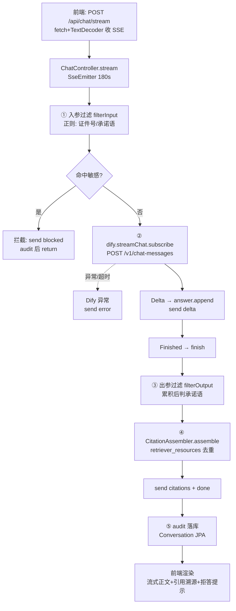
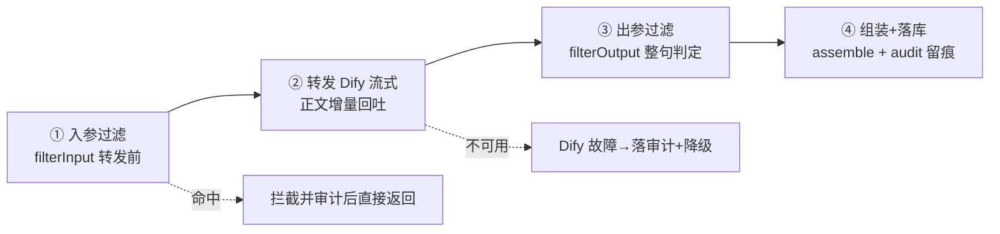
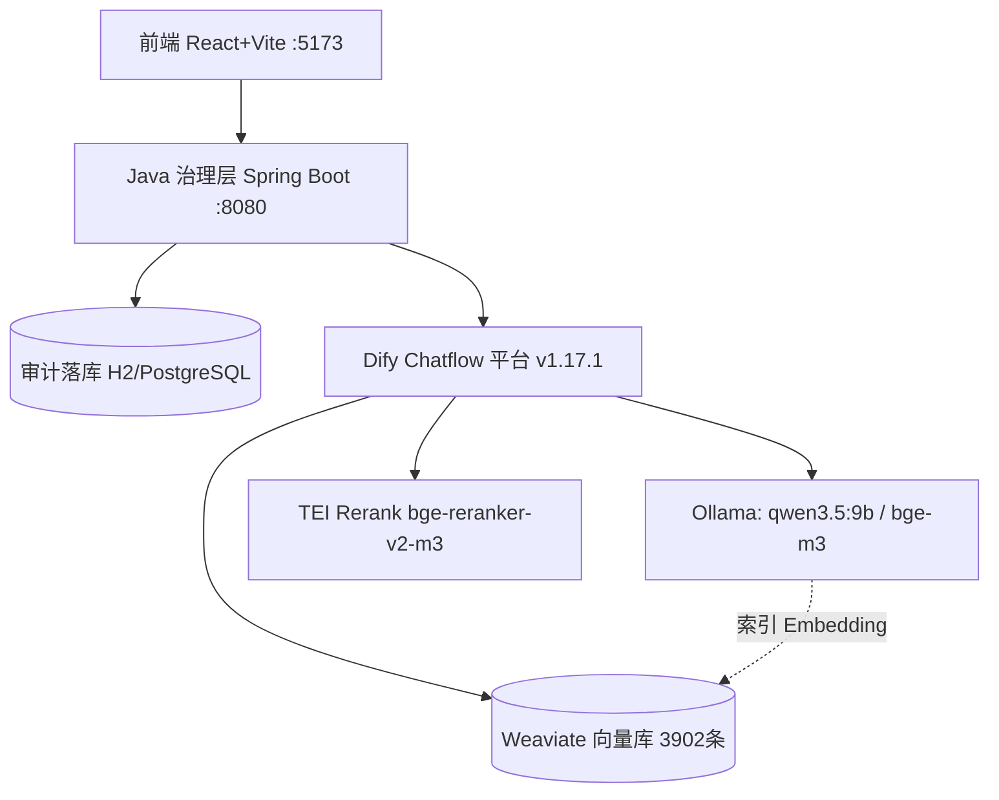
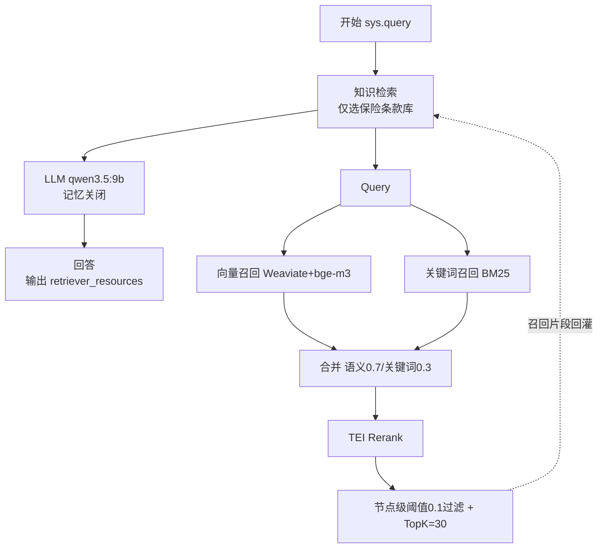
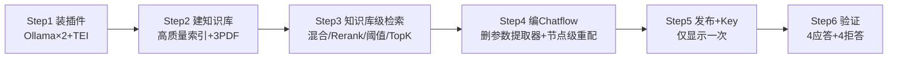
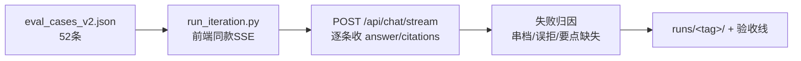
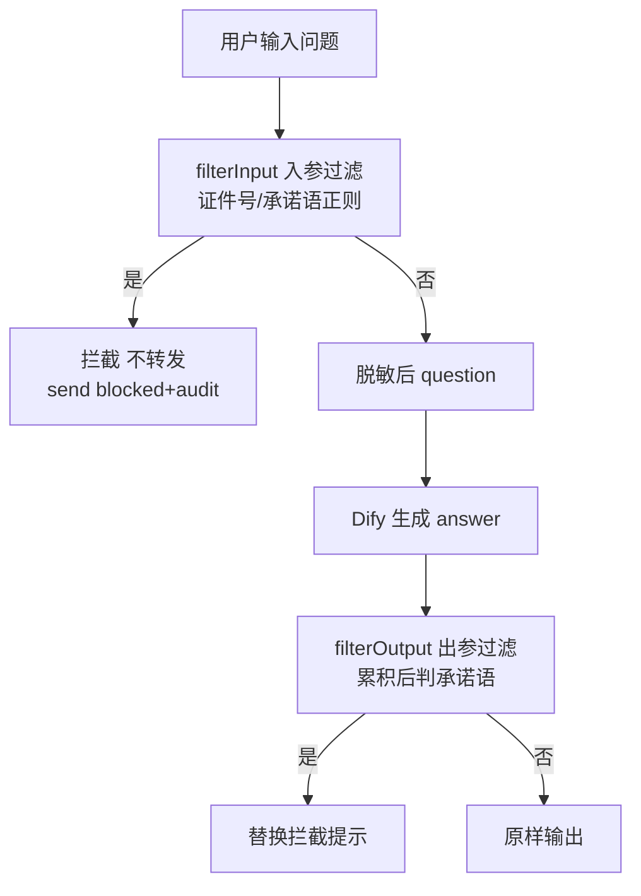

# 保险条款智能问答助手 — 项目流程图

> 由 `scripts/gen_flowcharts.py` 生成。Mermaid 版与 `docs/项目流程图.html` 同步维护。
> 数据来源：`README.md` / `docs/Dify-RAG工作流搭建手册.md` / 后端 Java 源码。

## 问答主链路（端到端 SSE）

## 后端治理层四步编排 (ChatService)

## 整体架构图

## Dify Chatflow 检索链路

## Dify 工作流搭建流程（Step 1→6）

## 评测流程 (FR-09)

## 敏感数据过滤流程 (FR-08)

